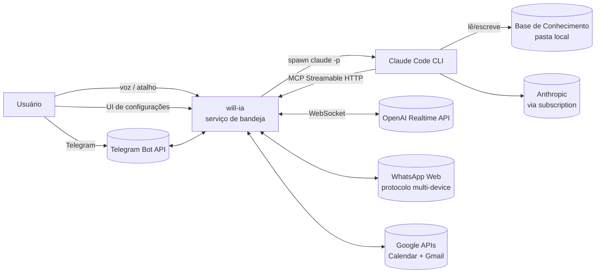
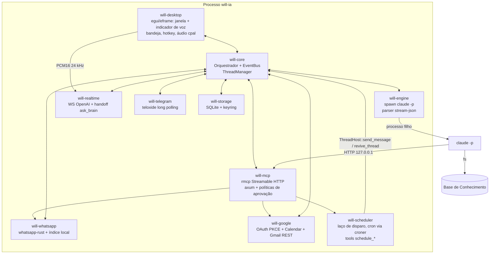
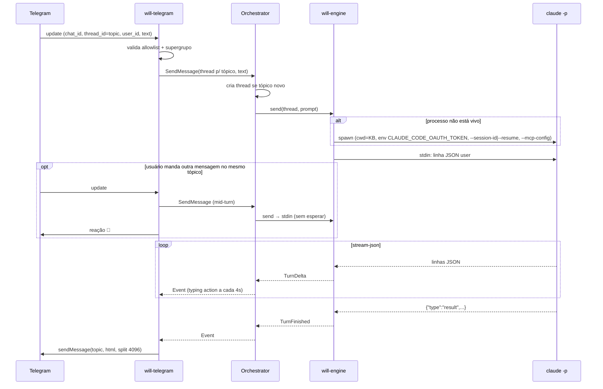
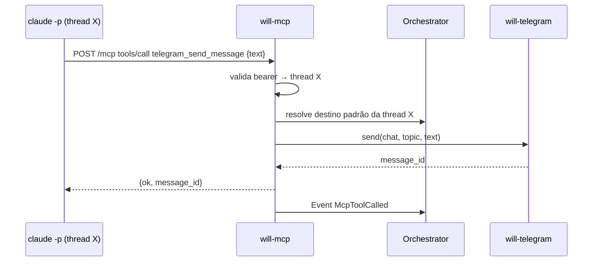

# 04 — Arquitetura

## Visão de contexto (C4 nível 1)



## Visão de contêineres (C4 nível 2)



## Como ficou implementado (2026-10-20)

- `crates/will-server` é a composição: `AppState`, `Host` (implementa `ThreadHost` e `BrainHost`), loop de eventos do motor → SQLite + `EventBus`, geração do `.mcp.json`, ciclo de vida dos módulos e API REST/WS local (`docs/22`, contrato interno/headless; não serve UI).
- `crates/will-desktop` é o **binário `will-ia`** (ADR-0016): app desktop nativo em egui/eframe que sobe o `will-server` **em processo** e adiciona janela principal, bandeja (`tray-icon` no Windows/macOS, `ksni` no Linux), atalho global (`global-hotkey`), seletor de pasta (`rfd`), áudio da voz com `cpal` e o indicador flutuante de voz. Modos: `will-ia` (serviço + bandeja + janela, que fecha para a bandeja), `will-ia --show` (força a janela), segunda execução com o serviço no ar → `POST /api/ui/show` na instância ativa e sai, `will-ia serve [--port --data-dir --file-secrets]` (headless: só serviço + API).
- A UI React (`ui/`) e a casca Tauri (`apps/will-desktop`) foram removidas; a UI nativa espelha as páginas da antiga web (Dashboard, Threads, Aprovações, Logs, Configurações).
- O orquestrador descrito abaixo como `will-core::Orchestrator` vive em `will-server::orchestrator`; `will-core` ficou só com tipos, eventos, settings e contratos.

## Organização do código (Cargo workspace)

```
will-ia/
├── Cargo.toml                 # workspace
├── crates/
│   ├── will-core/             # domínio: Thread, Turn, Origin, eventos, Orchestrator, traits
│   ├── will-engine/           # ClaudeEngine: spawn, stream-json parser, pool de processos
│   ├── will-storage/          # SQLite (sqlx), migrations, SecretStore (keyring)
│   ├── will-mcp/              # servidor MCP (rmcp + axum), registro de ferramentas
│   ├── will-telegram/         # bot (teloxide), mapeamento tópico↔thread, formatação
│   ├── will-realtime/         # cliente Realtime WS, handoff ask_brain, PTT (recebe PCM16 do app ou do WS headless)
│   ├── will-whatsapp/         # pareamento, índice local, WhatsAppBackend (whatsapp-rust), tools whatsapp_*
│   ├── will-google/           # OAuth (PKCE/loopback), GoogleClient, calendar/, gmail/, tools calendar_* e gmail_*
│   ├── will-scheduler/        # agendamentos: laço de disparo, cron (croner + chrono-tz), tools schedule_*, recriação da thread dona
│   ├── will-platform/         # autostart, notificações, abrir pasta/URL, paths (cfg por SO)
│   ├── will-server/           # composição: AppState, Host, API local, módulos, .mcp.json
│   └── will-desktop/          # binário `will-ia`: egui/eframe, bandeja, hotkey, áudio cpal, indicador de voz, modo `serve`
├── tools/fake-claude/         # simulador do `claude -p` para testes
├── packaging/                 # linux/ (.desktop), systemd/ (user unit), macos/ (bundle) — a fazer
├── scripts/smoke.sh
├── docs/
├── CLAUDE.md
└── README.md
```

Regras de dependência (setas = "depende de"):

```
will-desktop → will-server (serviço em processo), will-core, will-platform
will-server → will-core, will-storage, todos os módulos (wiring)
will-engine, will-telegram, will-realtime, will-mcp, will-whatsapp, will-google, will-scheduler → will-core, will-storage
will-mcp → traits de ferramentas expostas por will-telegram, will-whatsapp, will-google, will-scheduler (via will-core::ToolProvider)
will-scheduler → will-core::ThreadHost (send_message, get_thread, revive_thread) para entregar os disparos
will-storage → will-core (apenas tipos)
will-core → nada interno (apenas tokio, serde, thiserror, uuid, chrono)
```

`will-core` define as **traits** (`Engine`, `Channel`, `SecretStore`, `ThreadRepository`) e os tipos de evento. Os demais crates implementam. Isso permite testar o orquestrador com mocks e trocar implementações.

## Componentes principais

### Orchestrator (will-core)

Único dono do estado em memória. Recebe comandos (`Command`) e emite eventos (`Event`) por um `tokio::sync::broadcast`. Todos os módulos são *clientes* do orquestrador.

```rust
pub enum Command {
    CreateThread { origin: Origin, title: Option<String>, reply: oneshot::Sender<ThreadId> },
    SendMessage  { thread_id: ThreadId, input: TurnInput, reply: oneshot::Sender<MessageId> }, // inicia turno ou adiciona contexto a um turno em andamento
    Interrupt    { thread_id: ThreadId },   // interrompe o turno atual, mantém o processo vivo
    SuspendThread{ thread_id: ThreadId },   // encerra o processo; retomável com --resume
    DeleteThread { thread_id: ThreadId, purge_session: bool },
    ReloadModule { module: Module },
    Shutdown,
}

pub enum Event {
    ThreadCreated(ThreadSummary),
    TurnStarted  { thread_id, turn_id },
    MessageAccepted { thread_id, message_id, mid_turn: bool },  // via --replay-user-messages
    TurnDelta    { thread_id, turn_id, delta: EngineDelta },   // texto parcial, tool_use, etc.
    TurnFinished { thread_id, turn_id, result: TurnResult },   // texto final, custo, duração
    TurnFailed   { thread_id, turn_id, error: EngineError },
    ModuleStatus { module: Module, status: ModuleStatus },
    McpToolCalled{ thread_id, tool: String, ok: bool },
}
```

### ThreadManager (will-core)

- Mantém `HashMap<ThreadId, ThreadState>`; cada thread em estado `Live` possui um handle para o processo `claude` em execução (`EngineSession`).
- Mensagens para uma thread `Live` são escritas direto no stdin do processo, **mesmo durante um turno em andamento** (steering). Não há fila por thread.
- Mensagens para uma thread `Suspended` (processo encerrado por ociosidade/reinício) disparam `--resume` e depois a escrita.
- Limite global de processos vivos; política LRU para suspender threads ociosas quando o limite é atingido.
- Persiste transições via `ThreadRepository`.

### ClaudeEngine (will-engine)

Detalhado em [05 — Motor Claude Code](05-motor-claude-code.md). Resumo: por thread, spawna **um** `claude -p` no `cwd` da KB com stdin aberto em stream-json; escreve cada mensagem do usuário como uma linha JSON (inclusive no meio de um turno), lê stdout linha a linha e converte em `EngineDelta`; cada evento `result` fecha um turno lógico. O processo só termina por ociosidade, cancelamento ou shutdown.

### Canais (will-telegram, will-realtime, UI)

Implementam a trait `Channel`:

```rust
#[async_trait]
pub trait Channel: Send + Sync {
    fn origin(&self) -> OriginKind;
    async fn start(&self, orchestrator: OrchestratorHandle) -> Result<()>;
    async fn stop(&self) -> Result<()>;
    /// Entrega o resultado de um turno ao destino de origem.
    async fn deliver(&self, target: &OriginRef, outcome: &TurnOutcome) -> Result<()>;
}
```

Cada canal assina os eventos do orquestrador e filtra os que pertencem a threads da sua origem.

### Servidor MCP (will-mcp)

Detalhado em [09 — Servidor MCP](09-servidor-mcp.md). É um servidor axum com o handler Streamable HTTP do `rmcp`. Identifica a thread chamadora pelo bearer token, aplica a **política** da ferramenta (`auto` / `confirmar` / `desligada`) e despacha para o `ToolRegistry`. Cada módulo que oferece ferramentas (Telegram, WhatsApp, Google) implementa `ToolProvider` e registra suas `WillTool`s quando está ativo; o registro muda dinamicamente e dispara `tools/list_changed`.

### Módulos de ferramentas (will-whatsapp, will-google, will-scheduler)

Não são canais de entrada: não criam threads. Mantêm sessão/autorização, estado local (índice do WhatsApp, lista de agendas) e expõem ferramentas. Detalhes em [17](17-whatsapp.md), [18](18-conta-google.md), [19](19-google-agenda.md) e [20](20-gmail.md).

`will-scheduler` ([24](24-scheduler.md)) é um módulo de ferramentas com página própria na UI: um laço único dorme até o próximo `next_run_at` e, no horário, entrega a mensagem do agendamento à thread dona por `ThreadHost::send_message` (stdin, inclusive mid-turn). Única exceção à regra acima: se a thread dona foi apagada, ele a **recria** com a mesma origem e sessão via `ThreadHost::revive_thread` (ADR-0017).

### Catálogo de MCPs externos e gerador de `.mcp.json` (will-core::mcp_catalog)

Mantém os servidores externos cadastrados, testa conexões (cliente `rmcp`) e regenera `<kb>/.mcp.json` com a união `will_ia` + externos habilitados, usando `${VAR}` para segredos e para o bearer por thread. Detalhes em [21](21-mcps-externos.md).

### Aprovações (will-core::approvals)

Fila de pedidos de aprovação gerada pelo MCP para ferramentas em `confirmar`. Cada pedido é difundido como `Event::ApprovalRequested` e pode ser decidido pela UI, por notificação ou por botões inline no Telegram (`Command::DecideApproval`). Timeout configurável nega automaticamente.

### Storage (will-storage)

SQLite via `sqlx` (modo WAL) no diretório de dados do usuário. Segredos via crate `keyring`. Detalhado em [11 — Persistência](11-persistencia.md).

### App desktop egui (will-desktop)

- Binário `will-ia`; sobe o `will-server` no mesmo processo e roda o loop do `eframe` na thread principal.
- Janela principal (oculta por padrão após o onboarding; `--show` ou a bandeja a mostram; fechar só esconde) com navegação lateral: Dashboard, Threads, Aprovações, Logs, Configurações.
- Modo imediato: cada página lê um snapshot de `Arc<AppState>` e dispara ações assíncronas no tokio; respostas voltam por canais e `request_repaint` dirigido por eventos do `EventBus`. Sem lógica de negócio.
- Bandeja (`tray-icon` no Windows/macOS, `ksni` no Linux) com menu Abrir / Voz / Sair e ícone de estado; atalho global (`global-hotkey`) para toggle/PTT; diálogo de pasta (`rfd`); notificações e autostart via `will-platform`.
- Áudio da voz com `cpal` (PCM16 mono 24 kHz, reamostragem linear) entregue ao `RealtimeManager` sem WebSocket; indicador flutuante de voz como viewport secundário (sem decoração, sempre no topo).
- Instância única: a segunda execução chama `POST /api/ui/show` com o token local e sai.

## Fluxos principais

### Fluxo 1 — Mensagem Telegram



### Fluxo 2 — Voz com delegação ao cérebro

```mermaid
sequenceDiagram
    participant U as Usuário
    participant RTM as will-realtime
    participant OAI as OpenAI Realtime
    participant ORC as Orchestrator
    participant CC as claude -p
    U->>RTM: atalho global (will-desktop)
    RTM->>OAI: WS connect + session.update (tools: ask_brain)
    U->>RTM: fala (PCM16 24 kHz capturado pelo cpal no app)
    RTM->>OAI: input_audio_buffer.append
    OAI-->>RTM: response.audio.delta (fala imediata)
    OAI-->>RTM: response.function_call_arguments.done (ask_brain)
    RTM->>ORC: SendMessage(thread "voz", prompt)
    RTM->>OAI: (opcional) response.create "estou verificando"
    ORC->>CC: stdin (processo vivo, em paralelo)
    opt usuário complementa por voz
        OAI-->>RTM: ask_brain (novo contexto)
        RTM->>ORC: SendMessage (mid-turn)
        ORC->>CC: stdin
    end
    CC-->>ORC: TurnFinished
    ORC-->>RTM: Event
    RTM->>OAI: conversation.item.create(function_call_output)
    RTM->>OAI: response.create
    OAI-->>RTM: áudio com a resposta
    RTM-->>U: reprodução (cpal no app; indicador flutuante mostra o estado)
```

### Fluxo 3 — Agente usa ferramenta MCP



## Concorrência e runtime

- Um único runtime `tokio` multi-thread, criado pelo binário (`will-desktop` em ambos os modos) e compartilhado via `tokio::runtime::Handle`; a thread principal fica com o loop de eventos do `eframe`/winit (no modo `serve` não há loop de UI).
- Áudio roda fora do tokio, em threads do `cpal`, comunicando-se por canais `tokio::sync::mpsc` com buffer limitado.
- Processos filhos de longa duração (um por thread viva) via `tokio::process::Command` com `kill_on_drop(true)`; stdin mantido aberto e guardado no `EngineSession`; no Windows, adicionalmente atribuídos a um Job Object para encerramento em cascata.
- Nenhum `Mutex` segurado através de `.await`; estado compartilhado via ator (Orchestrator) e não via locks.

## Configuração e ciclo de vida

1. `main` (`will-desktop`) → se o serviço já está no ar, `POST /api/ui/show` e sai; senão cria `AppPaths`, abre SQLite, roda migrations, carrega `Settings`.
2. Instancia `Orchestrator` e módulos; cada módulo com `enabled` verdadeiro recebe `start()`.
3. Bandeja criada e loop do `eframe` iniciado; se primeira execução (ou `--show`), a janela aparece com o onboarding. No modo `serve`, pula este passo.
4. Alteração de settings → `ReloadModule(x)` → `stop()` + `start()` apenas do módulo afetado.
5. `Shutdown` → cancela turnos, mata processos filhos, fecha WS, encerra bot, flush do SQLite.

## Decisões registradas

Ver [docs/adr/](adr/README.md).
