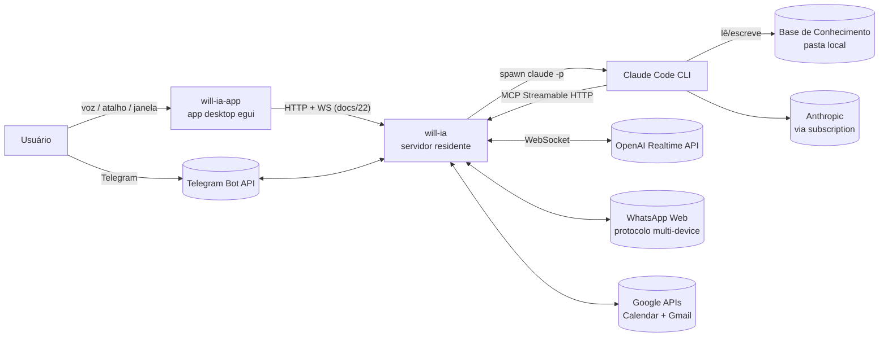
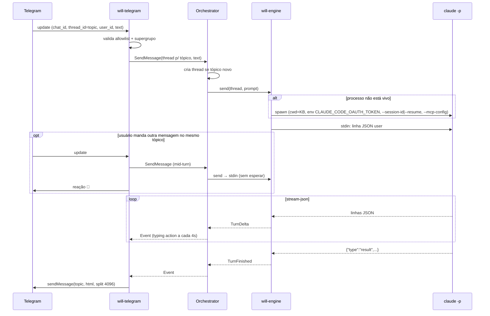
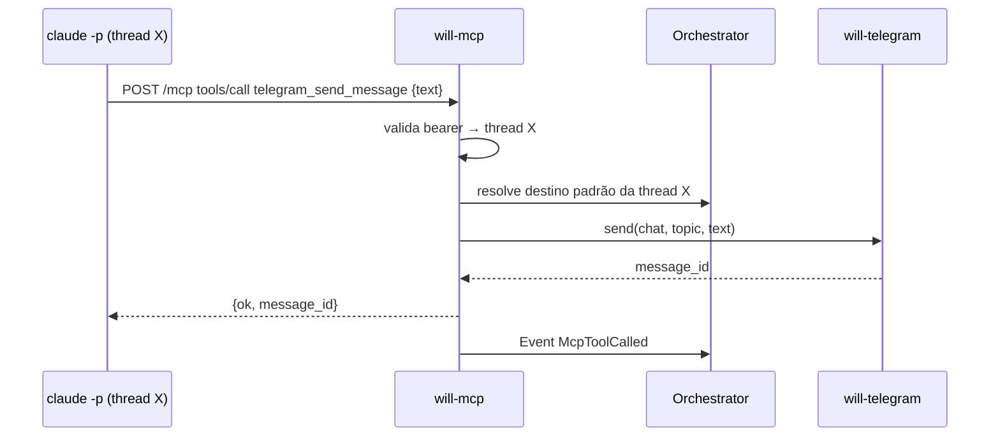

# 04 — Arquitetura

## Visão de contexto (C4 nível 1)



## Visão de contêineres (C4 nível 2)

```mermaid
flowchart TB
    subgraph APPP[Processo will-ia-app]
        UI[will-app\negui/eframe: janela + indicador de voz\nhotkey PTT, áudio cpal, perfis, ipc do app]
        CLI[will-client\nreqwest + WS eventos + WS áudio]
        UI <--> CLI
    end
    subgraph APP[Processo will-ia: servidor]
        SRV[will-ia bin\nCLI, bandeja ksni/tray-icon, lança o app\ninstance.lock, sinais]
        API[will-server\nAppState · API axum · WS]
        CORE[will-core\nOrquestrador + EventBus\nThreadManager]
        ENG[will-engine\nspawn claude -p\nparser stream-json]
        RTM[will-realtime\nWS OpenAI + handoff ask_brain]
        TGM[will-telegram\nteloxide long polling]
        MCP[will-mcp\nrmcp Streamable HTTP\naxum + políticas de aprovação]
        WAM[will-whatsapp\nwhatsapp-rust + índice local]
        GGL[will-google\nOAuth PKCE + Calendar + Gmail REST]
        SCH[will-scheduler\nlaço de disparo, cron via croner\ntools schedule_*]
        BRW[will-browser\nproxy CDP 127.0.0.1:9223\nlançamento do navegador, log de tráfego]
        STO[will-storage\nSQLite + keyring]
        SRV --> API
        API <--> CORE
        API -- PCM16 24 kHz (WS /api/voice/audio) --> RTM
        CORE <--> ENG
        CORE <--> RTM
        CORE <--> TGM
        CORE <--> MCP
        MCP --> WAM
        MCP --> GGL
        MCP --> SCH
        CORE <--> WAM
        CORE <--> GGL
        SCH -- ThreadHost::send_message / revive_thread --> CORE
        CORE <--> BRW
        CORE <--> STO
    end
    CLI -- HTTP/WS 127.0.0.1 ou rede --> API
    SRV -. bandeja "Abrir will-ia" / POST /api/ui/show .-> UI
    ENG -- processo filho --> CLAUDE[claude -p]
    CLAUDE -- Bash agent-browser --> AB[agent-browser CLI]
    AB -- CDP HTTP/WS 127.0.0.1:9223 --> BRW
    BRW -- CDP 127.0.0.1:9222 --> CHROME[Chrome/Chromium\nperfil dedicado]
    CLAUDE -- HTTP 127.0.0.1 --> MCP
    CLAUDE -- fs --> KB[(Base de Conhecimento)]
```

## Como ficou implementado (2026-10-28, dois binários)

- `crates/will-server` é a composição: `AppState`, `Host` (implementa `ThreadHost` e `BrainHost`), loop de eventos do motor → SQLite + `EventBus`, geração do `.mcp.json`, ciclo de vida dos módulos e API REST/WS (`docs/22`): desde a fase 5 (`docs/26`, ADR-0019) essa API é o **contrato entre o app e o servidor**.
- `crates/will-ia` é o **binário `will-ia` (servidor)**: sobe o `will-server` (inclui `axum-server`/`rustls` para TLS opcional e `rcgen` para o certificado autoassinado; `argon2` para senhas), grava `<data_dir>/api-port`, toma o trinco `instance.lock` e, se há sessão gráfica (`DISPLAY`/`WAYLAND_DISPLAY`; sempre no Windows/macOS), põe um ícone na bandeja (`ksni` no Linux, `tray-icon` nos demais) cujo único item é **"Abrir will-ia"**, que lança o `will-ia-app` (ao lado do próprio executável ou no PATH). Modos: `will-ia [--show] [--no-tray] [--data-dir] [--file-secrets] [--port]` (residente: sinais ignorados; `--show` abre o app ao subir), `will-ia serve` (headless, encerra limpo com Ctrl+C/SIGTERM), `will-ia info` (caminhos, URL e token), `will-ia show` e `will-ia screenshot --nav <pagina>` (delegam ao app). Segunda execução com o trinco ocupado só abre o app e sai. `POST /api/ui/show` e `/api/ui/screenshot` também lançam/acionam o app.
- `crates/will-app` é o **binário `will-ia-app` (app)**: egui/eframe, cliente do servidor via `crates/will-client` (um método por rota de `docs/22`, WS de eventos com reconexão, WS de áudio). Não depende de `will-server`. Tem **perfis** de conexão (`<config>/will-ia-app/profiles.json`; "Esta máquina" descoberto por `api-port` + `ui-session.token`), página Conexão, atalho global PTT (`global-hotkey`), áudio com `cpal`, indicador flutuante de voz, `rfd` só para escolher arquivos a anexar. Instância única por trinco `app.lock` + TCP em loopback (`<config>/will-ia-app/ipc`): `will-ia-app` de novo (ou `show`, `screenshot --nav`) só manda o comando à instância aberta. Modos: `will-ia-app [--show|--hidden] [--url … --token …] [--profile nome]`, `show`, `screenshot --nav`, `audio-devices`.
- A UI React (`ui/`) e a casca Tauri (`apps/will-desktop`) foram removidas em 2026-10-20 (ADR-0016); o crate `will-desktop` (binário único GUI + serviço) foi dividido em `will-ia` + `will-app` em 2026-10-28 (etapa 3 de `docs/26`).
- O orquestrador descrito abaixo como `will-core::Orchestrator` vive em `will-server::orchestrator`; `will-core` ficou só com tipos, eventos, settings e contratos.

## Organização do código (Cargo workspace)

```
will-ia/
├── Cargo.toml                 # workspace
├── crates/
│   ├── will-core/             # domínio: Thread, Turn, Origin, eventos, Orchestrator, traits
│   ├── will-engine/           # ClaudeEngine: spawn, stream-json parser, pool de processos
│   ├── will-storage/          # SQLite (sqlx), migrations, SecretStore (keyring)
│   ├── will-telemetry/        # Layer do tracing → OTLP/HTTP (Protobuf): logs, spans, heartbeat de uso, spool, redação
│   ├── will-mcp/              # servidor MCP (rmcp + axum), registro de ferramentas
│   ├── will-telegram/         # bot (teloxide), mapeamento tópico↔thread, formatação
│   ├── will-realtime/         # cliente Realtime WS, handoff ask_brain, PTT (recebe PCM16 do app ou do WS headless)
│   ├── will-whatsapp/         # pareamento, índice local, WhatsAppBackend (whatsapp-rust), tools whatsapp_*
│   ├── will-google/           # OAuth (PKCE/loopback), GoogleClient, calendar/, gmail/, tools calendar_* e gmail_*
│   ├── will-scheduler/        # agendamentos: laço de disparo, cron (croner + chrono-tz), tools schedule_*, recriação da thread dona
│   ├── will-browser/          # Browser CDP: proxy loopback para o agent-browser, lançamento do navegador, log de tráfego, instalação do CLI/skill
│   ├── will-platform/         # autostart, notificações, abrir pasta/URL, paths (cfg por SO)
│   ├── will-server/           # composição: AppState, Host, API local, módulos, .mcp.json
│   ├── will-client/           # cliente tipado da API (reqwest + WS eventos + WS áudio); usado pelo app e por automações
│   ├── will-ia/               # binário `will-ia` (servidor): CLI, bandeja ksni/tray-icon, lançador do app, trinco, sinais
│   └── will-app/              # binário `will-ia-app` (app): egui/eframe, perfis, ipc do app, hotkey, áudio cpal, indicador de voz
├── tools/fake-claude/         # simulador do `claude -p` para testes
├── packaging/                 # linux/ (.desktop), systemd/ (user unit), macos/ (Info.plist), portable/ (lançadores)
├── scripts/smoke.sh
├── docs/
├── CLAUDE.md
└── README.md
```

Regras de dependência (setas = "depende de"):

```
will-app → will-client, will-core (tipos/serde), will-platform (hotkey, notificações, instance lock, which); NUNCA will-server
will-client → will-core (Event, tipos), reqwest, tokio-tungstenite
will-ia → will-server, will-core, will-platform (instance lock, which, has_desktop); sem egui
will-server → will-core, will-storage, todos os módulos (wiring)
will-engine, will-telegram, will-realtime, will-mcp, will-whatsapp, will-google, will-scheduler → will-core, will-storage
will-browser → will-core (settings, EventBus, hide_console), will-platform (which, die_with_parent, attach_to_job); sem storage, sem ToolProvider
will-mcp → traits de ferramentas expostas por will-telegram, will-whatsapp, will-google, will-scheduler (via will-core::ToolProvider)
will-scheduler → will-core::ThreadHost (send_message, get_thread, revive_thread) para entregar os disparos
will-storage → will-core (apenas tipos)
will-core → nada interno (apenas tokio, serde, thiserror, uuid, chrono)
```

`will-core` define as **traits** (`Engine`, `Channel`, `SecretStore`, `ThreadRepository`) e os tipos de evento. Os demais crates implementam. Isso permite testar o orquestrador com mocks e trocar implementações.

## Componentes principais

### Orchestrator (will-core)

Único dono do estado em memória. Recebe comandos (`Command`) e emite eventos (`Event`) por um `tokio::sync::broadcast`. Todos os módulos são *clientes* do orquestrador.

```rust
pub enum Command {
    CreateThread { origin: Origin, title: Option<String>, reply: oneshot::Sender<ThreadId> },
    SendMessage  { thread_id: ThreadId, input: TurnInput, reply: oneshot::Sender<MessageId> }, // inicia turno ou adiciona contexto a um turno em andamento
    Interrupt    { thread_id: ThreadId },   // interrompe o turno atual, mantém o processo vivo
    SuspendThread{ thread_id: ThreadId },   // encerra o processo; retomável com --resume
    DeleteThread { thread_id: ThreadId, purge_session: bool },
    ReloadModule { module: Module },
    Shutdown,
}

pub enum Event {
    ThreadCreated(ThreadSummary),
    TurnStarted  { thread_id, turn_id },
    MessageAccepted { thread_id, message_id, mid_turn: bool },  // via --replay-user-messages
    TurnDelta    { thread_id, turn_id, delta: EngineDelta },   // texto parcial, tool_use, etc.
    TurnFinished { thread_id, turn_id, result: TurnResult },   // texto final, custo, duração
    TurnFailed   { thread_id, turn_id, error: EngineError },
    ModuleStatus { module: Module, status: ModuleStatus },
    McpToolCalled{ thread_id, tool: String, ok: bool },
}
```

### ThreadManager (will-core)

- Mantém `HashMap<ThreadId, ThreadState>`; cada thread em estado `Live` possui um handle para o processo `claude` em execução (`EngineSession`).
- Mensagens para uma thread `Live` são escritas direto no stdin do processo, **mesmo durante um turno em andamento** (steering). Não há fila por thread.
- Mensagens para uma thread `Suspended` (processo encerrado por ociosidade/reinício) disparam `--resume` e depois a escrita.
- Limite global de processos vivos; política LRU para suspender threads ociosas quando o limite é atingido.
- Persiste transições via `ThreadRepository`.

### ClaudeEngine (will-engine)

Detalhado em [05 — Motor Claude Code](05-motor-claude-code.md). Resumo: por thread, spawna **um** `claude -p` no `cwd` da KB com stdin aberto em stream-json; escreve cada mensagem do usuário como uma linha JSON (inclusive no meio de um turno), lê stdout linha a linha e converte em `EngineDelta`; cada evento `result` fecha um turno lógico. O processo só termina por ociosidade, cancelamento ou shutdown.

### Canais (will-telegram, will-realtime, UI)

Implementam a trait `Channel`:

```rust
#[async_trait]
pub trait Channel: Send + Sync {
    fn origin(&self) -> OriginKind;
    async fn start(&self, orchestrator: OrchestratorHandle) -> Result<()>;
    async fn stop(&self) -> Result<()>;
    /// Entrega o resultado de um turno ao destino de origem.
    async fn deliver(&self, target: &OriginRef, outcome: &TurnOutcome) -> Result<()>;
}
```

Cada canal assina os eventos do orquestrador e filtra os que pertencem a threads da sua origem.

### Servidor MCP (will-mcp)

Detalhado em [09 — Servidor MCP](09-servidor-mcp.md). É um servidor axum com o handler Streamable HTTP do `rmcp`. Identifica a thread chamadora pelo bearer token, aplica a **política** da ferramenta (`auto` / `confirmar` / `desligada`) e despacha para o `ToolRegistry`. Cada módulo que oferece ferramentas (Telegram, WhatsApp, Google) implementa `ToolProvider` e registra suas `WillTool`s quando está ativo; o registro muda dinamicamente e dispara `tools/list_changed`.

### Módulos de ferramentas (will-whatsapp, will-google, will-scheduler)

Não são canais de entrada: não criam threads. Mantêm sessão/autorização, estado local (índice do WhatsApp, lista de agendas) e expõem ferramentas. Detalhes em [17](17-whatsapp.md), [18](18-conta-google.md), [19](19-google-agenda.md) e [20](20-gmail.md).

`will-scheduler` ([24](24-scheduler.md)) é um módulo de ferramentas com página própria na UI: um laço único dorme até o próximo `next_run_at` e, no horário, entrega a mensagem do agendamento à thread dona por `ThreadHost::send_message` (stdin, inclusive mid-turn). Única exceção à regra acima: se a thread dona foi apagada, ele a **recria** com a mesma origem e sessão via `ThreadHost::revive_thread` (ADR-0017).

`will-browser` ([25](25-browser-cdp.md), ADR-0018) é um módulo de ferramentas sem ferramentas MCP: o agente navega pelo CLI `agent-browser` (skill na KB, `Bash(agent-browser:*)`), que fala CDP com um **proxy em loopback** do serviço (`127.0.0.1:9223`, injetado em `AGENT_BROWSER_CDP`). O proxy repassa ao navegador real (`127.0.0.1:9222`), reescreve a descoberta `/json*`, registra o tráfego WebSocket para a página Browser CDP e, se ninguém responde, **lança o navegador** com perfil dedicado antes de repassar. Também instala o CLI, o Chromium e a skill pela UI.

### Catálogo de MCPs externos e gerador de `.mcp.json` (will-core::mcp_catalog)

Mantém os servidores externos cadastrados, testa conexões (cliente `rmcp`) e regenera `<kb>/.mcp.json` com a união `will_ia` + externos habilitados, usando `${VAR}` para segredos e para o bearer por thread. Detalhes em [21](21-mcps-externos.md).

### Aprovações (will-core::approvals)

Fila de pedidos de aprovação gerada pelo MCP para ferramentas em `confirmar`. Cada pedido é difundido como `Event::ApprovalRequested` e pode ser decidido pela UI, por notificação ou por botões inline no Telegram (`Command::DecideApproval`). Timeout configurável nega automaticamente.

### Storage (will-storage)

SQLite via `sqlx` (modo WAL) no diretório de dados do usuário. Segredos via crate `keyring`. Detalhado em [11 — Persistência](11-persistencia.md).

### Servidor (`will-ia`, crate `crates/will-ia`)

- Sobe o `will-server` num runtime tokio multi-thread, grava `api-port`, instala o gancho `ui_hook` (usado por `POST /api/ui/show` e `/api/ui/screenshot` para lançar/acionar o app) e fica residente (sinais ignorados) ou headless (`serve`).
- Bandeja só com sessão gráfica: um item, "Abrir will-ia" (clique no ícone faz o mesmo). Sem "Sair", sem estado de voz (voz é do app).
- Lançador (`launcher.rs`): procura `will-ia-app` ao lado do executável e depois no PATH; `open_app` não espera, `run_app` espera (captura de tela).

### App desktop (`will-ia-app`, crate `crates/will-app`)

- Loop do `eframe` na thread principal; runtime tokio para o `will-client`. Snapshot inicial por `/api/status` + `/api/settings` + `/api/approvals`; depois o WS `/api/events` mantém o estado (reconexão com backoff; "desconectado" visível). Sem lógica de negócio.
- Janela principal com navegação lateral: Dashboard, Threads, Agendamentos, Browser CDP, Aprovações, Logs, Custos, Conexão, Configurações. Abre visível por padrão (`--hidden` para só atalho + ipc). Fechar só oculta **enquanto o processo do app existir**; o app não é residente (o servidor é).
- Perfis (`profiles.rs`): `--url/--token` > `--profile` > último usado > "Esta máquina" > primeiro salvo. Trocar de perfil fecha o WS, limpa o snapshot e reconecta.
- Instância única e comandos (`app_ipc.rs`): trinco `app.lock` na pasta de configuração + TCP em loopback com token em `ipc`; comandos `show` e `screenshot[:nav]`. A bandeja do servidor e `will-ia show` passam por aqui ao relançar o binário.
- Atalho global (`global-hotkey`) para toggle/PTT; áudio com `cpal` (PCM16 mono 24 kHz) pelo WS `/api/voice/audio` do servidor; indicador flutuante de voz como viewport secundário. Ações locais (abrir pasta, `rfd` para a KB, miniaturas `file://`) só quando o servidor é esta máquina; senão `kb/browse`, `uploads` e `files` pela API.

## Fluxos principais

### Fluxo 1 — Mensagem Telegram



### Fluxo 2 — Voz com delegação ao cérebro

```mermaid
sequenceDiagram
    participant U as Usuário
    participant RTM as will-realtime
    participant OAI as OpenAI Realtime
    participant ORC as Orchestrator
    participant CC as claude -p
    U->>RTM: atalho global (will-ia-app) → POST /api/voice/start
    RTM->>OAI: WS connect + session.update (tools: ask_brain)
    U->>RTM: fala (PCM16 24 kHz capturado pelo cpal no app)
    RTM->>OAI: input_audio_buffer.append
    OAI-->>RTM: response.audio.delta (fala imediata)
    OAI-->>RTM: response.function_call_arguments.done (ask_brain)
    RTM->>ORC: SendMessage(thread "voz", prompt)
    RTM->>OAI: (opcional) response.create "estou verificando"
    ORC->>CC: stdin (processo vivo, em paralelo)
    opt usuário complementa por voz
        OAI-->>RTM: ask_brain (novo contexto)
        RTM->>ORC: SendMessage (mid-turn)
        ORC->>CC: stdin
    end
    CC-->>ORC: TurnFinished
    ORC-->>RTM: Event
    RTM->>OAI: conversation.item.create(function_call_output)
    RTM->>OAI: response.create
    OAI-->>RTM: áudio com a resposta
    RTM-->>U: reprodução (cpal no app; indicador flutuante mostra o estado)
```

### Fluxo 3 — Agente usa ferramenta MCP



## Concorrência e runtime

- No servidor, um único runtime `tokio` multi-thread criado pelo binário `will-ia` (residente ou `serve`) e compartilhado via `tokio::runtime::Handle`. No app, outro runtime para o `will-client`; a thread principal fica com o loop de eventos do `eframe`/winit.
- Áudio roda fora do tokio, em threads do `cpal`, comunicando-se por canais `tokio::sync::mpsc` com buffer limitado.
- Processos filhos de longa duração (um por thread viva) via `tokio::process::Command` com `kill_on_drop(true)`; stdin mantido aberto e guardado no `EngineSession`; no Windows, adicionalmente atribuídos a um Job Object para encerramento em cascata.
- Nenhum `Mutex` segurado através de `.await`; estado compartilhado via ator (Orchestrator) e não via locks.

## Configuração e ciclo de vida

1. `main` (`will-ia`) → se o trinco `instance.lock` está ocupado, só lança o app e sai; senão cria `AppPaths`, abre SQLite, roda migrations, carrega `Settings`.
2. Instancia `Orchestrator` e módulos; cada módulo com `enabled` verdadeiro recebe `start()`. Grava `api-port`.
3. Bandeja criada se há desktop (e não `--no-tray`); com `--show`, lança o `will-ia-app`. No modo `serve`, nem bandeja nem app.
   O app, por sua vez: toma `app.lock` (ou encaminha `show` à instância aberta), escolhe o perfil, conecta, e mostra a janela (onboarding se o servidor ainda não tem motor/KB; página Conexão se nenhum servidor responde).
4. Alteração de settings → `ReloadModule(x)` → `stop()` + `start()` apenas do módulo afetado.
5. `Shutdown` → cancela turnos, mata processos filhos, fecha WS, encerra bot, flush do SQLite.

## Decisões registradas

Ver [docs/adr/](adr/README.md).
