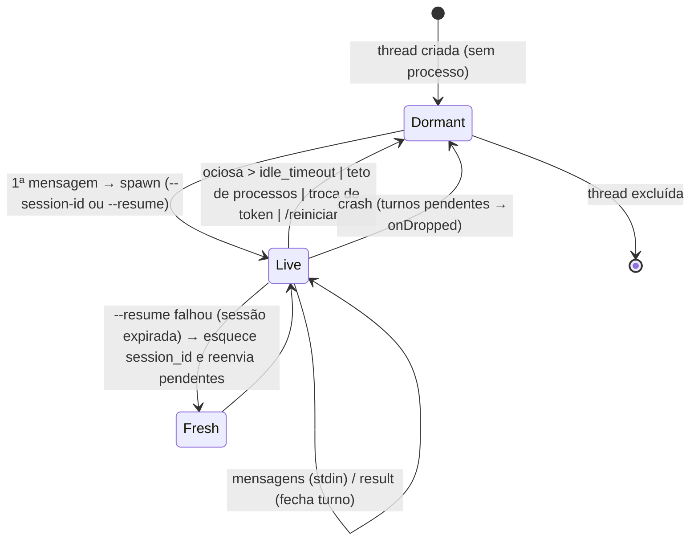

# 05 — Motor Claude Code (will-engine)

O "cérebro" do will-ia é o **Claude Code CLI** executado em modo não interativo (`-p`). O serviço **nunca chama a API da Anthropic diretamente**: ele spawna o binário `claude`, mantém o processo vivo e conversa com ele por stdin/stdout em linhas JSON (NDJSON).

> Flags verificadas com `claude --version` = 2.1.303. O engine deve checar a versão na inicialização e avisar se for inferior à mínima suportada.

## Modelo: um processo vivo por thread

Este é o ponto central do motor, herdado do projeto de referência (`telegram-bot`, ver [08](08-telegram.md)):

- Cada **thread** tem **um** processo `claude -p` com **stdin aberto**. O contexto da conversa vive na memória desse processo.
- Toda mensagem do usuário é escrita **na hora** no stdin, como uma linha JSON, **inclusive enquanto um turno está em andamento**. O Claude Code recebe essa mensagem e a incorpora: ou como contexto adicional do turno corrente (steering), ou como o próximo turno, a seu critério. É assim que voz e Telegram conseguem "continuar falando" enquanto o cérebro trabalha.
- Dentro de um processo os turnos são serializados; o **paralelismo** vem de ter N processos (N threads).
- O `session_id` é guardado apenas para **recuperação**: se o processo morrer (ocioso, crash, reinício do serviço, troca de token), a próxima mensagem respawna com `--resume <session_id>` e o contexto volta do disco.



## Autenticação por subscription

```bash
claude setup-token     # gera token de longa duração (sk-ant-oat01-…)
```

O token fica no keyring do SO e é injetado no processo filho como `CLAUDE_CODE_OAUTH_TOKEN`. Nunca em arquivo nem em log (logs mostram apenas rótulo e últimos 4 caracteres).

**Vários tokens, um ativo.** Troca de token **não reinicia o serviço**: o engine testa o novo token num `claude -p "Responda apenas: OK"` descartável (timeout 90 s; falha se stdout/stderr casar `unauthor|401|invalid|expired|rate limit|quota`), e, se passar, **derruba todos os processos vivos**. As sessões ficam salvas e cada thread volta com `--resume` e o token novo na próxima mensagem. Zero contexto perdido.

## Linha de comando por processo

```bash
claude -p \
  --input-format stream-json \
  --output-format stream-json \
  --verbose \
  --replay-user-messages \
  [--include-partial-messages] \
  --append-system-prompt "<orientações por canal, ver abaixo>" \
  --session-id <uuid>   | --resume <claude_session_id> \
  --mcp-config <kb>/.mcp.json [--strict-mcp-config] \
  --permission-prompts none \
  # modo acceptEdits:
  --permission-mode acceptEdits --allowedTools <lista> \
  # ou modo bypass:
  --permission-mode bypassPermissions --dangerously-skip-permissions \
  [--model <modelo>] [--max-budget-usd <valor>] [--effort <nível>]
```

| Item | Detalhe |
|---|---|
| `cwd` | pasta da base de conhecimento. O Claude Code carrega `CLAUDE.md` e `.claude/` de lá. |
| `--replay-user-messages` | o CLI ecoa cada mensagem de usuário recebida; o engine usa isso como **ack** e emite `MessageAccepted { mid_turn }`. |
| `--include-partial-messages` | liga `stream_event` token a token. Só quando a UI está exibindo a thread ao vivo (é ~90% do volume de linhas). |
| `--permission-prompts none` | em headless não há quem responda prompts; ações fora do permitido são negadas em vez de travar. |
| `--append-system-prompt` | orientações de formato por canal (Telegram: texto simples; Realtime: prosa falável) e aviso de **sessões paralelas na mesma pasta** (reler antes de editar). |

Variáveis de ambiente do processo filho:

| Variável | Valor |
|---|---|
| `CLAUDE_CODE_OAUTH_TOKEN` | token ativo |
| `WILL_IA_THREAD_ID` | id interno da thread |
| `WILL_IA_ORIGIN` | `ui` / `telegram` / `realtime` |
| `WILL_IA_MCP_URL` | URL do servidor MCP local (para scripts em `tools/`) |
| `AGENT_BROWSER_CDP` | `http://127.0.0.1:<browser.listen_port>` (padrão 9223): proxy CDP do serviço, lido pelo CLI `agent-browser`; só quando o módulo Browser CDP está habilitado (`docs/25`) |
| `AGENT_BROWSER_SCREENSHOT_DIR`, `AGENT_BROWSER_DOWNLOAD_PATH` | `<kb>/inbox/browser/`: capturas e downloads do `agent-browser` sem caminho explícito; só quando o módulo Browser CDP está ligado (`docs/25`). |

### Allowlist padrão (modo `acceptEdits`)

```
Read Write Edit MultiEdit Glob Grep LS WebSearch WebFetch Task TodoWrite
Bash(node tools/*) Bash(npm --prefix tools *) Bash(npx *)
Bash(python tools/*) Bash(python3 tools/*) Bash(py tools/*) Bash(pip install -r tools/requirements.txt)
Bash(ls *) Bash(cat *) Bash(mkdir *)
mcp__will_ia__*
```

Editável nas configurações. Com o módulo Browser CDP habilitado e `allow_agent_browser_tool` ligado, o serviço acrescenta `Bash(agent-browser:*)` (se a lista ainda não tiver uma entrada `Bash(agent-browser…`), para o agente navegar pelo CLI sem pedir permissão (`docs/25`). Negações detectadas no stream geram um aviso na UI ("o agente tentou X e foi bloqueado").

## Protocolo stream-json

### Entrada (stdin) — uma linha por mensagem

```json
{"type":"user","message":{"role":"user","content":[{"type":"text","text":"<prompt>"}]}}
```

Anexos: salvos em `inbox/` e referenciados por caminho no texto (mais robusto que base64 inline).

### Saída (stdout) — tipos observados em logs reais do projeto de referência

| `type` / `subtype` | Frequência | Uso no engine |
|---|---|---|
| `system` / `init` | 1 por spawn | Captura `session_id`, `model`, `permissionMode`, `mcp_servers[]` (validar `will_ia` conectado), `tools[]`, `claude_code_version`. |
| `assistant` | por bloco de resposta | `message.content[]` com `text`, `tool_use`, `thinking`. Blocos `text` completos viram **narração** (`TurnDelta::Narration`) para a pilha de status. |
| `user` | por resultado de tool | `tool_use_result` (stdout/stderr/interrupted). Emitir `TurnDelta::ToolResult` resumido. Também é onde chega o **replay** das mensagens do usuário. |
| `result` / `success` ou `error_*` | 1 por turno | Fecha o turno: `result` (texto final), `is_error`, `total_cost_usd`, `duration_ms`, `duration_api_ms`, `usage`, `modelUsage`, `session_id`, `stop_reason`. |
| `stream_event` / `content_block_*`, `message_*` | muito alto | Só com `--include-partial-messages`. Deltas de texto/thinking para UI ao vivo. |
| `system` / `status`, `thinking_tokens`, `task_started`, `task_notification`, `hook_*` | médio | Telemetria; `task_*` indica subagentes. Logar em `debug`, mostrar `status` na UI. |
| `rate_limit_event` | baixo | Atualizar `ModuleStatus` do motor para `Degraded` e sugerir troca de token. |
| `tool_progress` | baixo | Progresso de tools longas; opcional na UI. |

Regras do parser:

- Tolerante: linha não-JSON ou tipo desconhecido → `debug` e segue. Nunca derruba a thread.
- Buffer por linhas (`\n`); o último fragmento parcial fica no buffer até completar.
- stderr capturado separadamente; usado para classificar erros (ver abaixo).
- Todo o stream bruto pode ser gravado em `logs/claude-<data>.log` (toggle de diagnóstico).

### Correlação de turnos

Cada thread mantém uma **fila de pendências** (`VecDeque<Pending { message_id, origin_ref, sent_at, retried }>`). Cada mensagem escrita no stdin entra na fila; cada `result` recebido **fecha a cabeça** da fila e entrega a resposta ao `origin_ref` dela (chat + tópico no Telegram, sessão de voz, janela da UI). Se o Claude Code consolidar duas mensagens num único turno, a segunda pendência é fechada pelo mesmo `result` (o engine fecha todas as pendências enviadas antes do início do turno que terminou, usando o replay como marcador de início).

## Supervisão do processo

| Situação | Detecção | Ação |
|---|---|---|
| Sessão expirada (`cleanupPeriodDays` do Claude Code apagou a transcrição) | stderr ou `result.errors[]` contém `No conversation found with session ID`; processo sai com código 1 | **Engolir** esse `result`; ao `exit`, esquecer `session_id`, respawnar do zero e **reenviar as pendências** (uma tentativa por mensagem, flag `retried`). Narrar "♻️ a sessão antiga expirou — comecei uma nova". |
| Crash com pendências | `exit` inesperado com fila não vazia | Para cada pendência: `TurnFailed(Dropped)`; canal avisa "reiniciou no meio — manda de novo". |
| Ociosidade | `now - last_used > idle_timeout` (padrão 10 min) e fila vazia; varredura a cada 60 s | `retire`: SIGTERM → 3 s → SIGKILL. Sessão mantida. |
| Teto de processos vivos (padrão 5) | ao precisar spawnar | Recolhe a thread **ociosa há mais tempo** com fila vazia. Se todas ocupadas, loga aviso e spawna mesmo assim (soft limit). |
| Encerramento do serviço | `Shutdown` | `retire` em todas; sessões mantidas. |
| Órfãos | — | Unix: processo filho em **grupo próprio** (`setsid`/`process_group(0)`), sinal enviado ao grupo (`-pid`) derruba shell da tool Bash e servidores MCP filhos. Windows: Job Object com `KILL_ON_JOB_CLOSE`. |
| Binário ausente | erro no spawn | `BinaryNotFound`; caminho configurável. |
| Auth inválida | stderr `not logged in` / 401 / `invalid` / `expired` | `AuthFailed`; motor `Degraded`; UI sugere `claude setup-token` ou trocar token ativo. |
| Rate limit | `rate_limit_event` ou stderr `rate limit|limit reached|quota` | `RateLimited`; motor `Degraded`; UI sugere trocar token. |

Comandos de manutenção por thread (expostos na UI e como comandos do Telegram):

| Comando | Efeito |
|---|---|
| **Reiniciar** (`/reiniciar`) | mata o processo, **mantém** a sessão → próximo envio faz `--resume`. |
| **Zerar** (`/novo`) | mata o processo e **esquece** a sessão → próximo envio começa do zero. |
| **Excluir** | mata o processo, esquece sessão, remove a thread do banco (e opcionalmente o `.jsonl` da sessão em `~/.claude/projects/<slug-do-cwd>/`). |
| **Interromper** | envia interrupção ao turno atual sem matar o processo (fallback: reiniciar). |

Saúde da sessão: o engine verifica se `~/.claude/projects/<slug>/<session_id>.jsonl` existe para marcar threads dormentes como "❌ sessão expirada (volta do zero)" no status.

## API interna do engine

```rust
pub struct EngineConfig { pub claude_bin: PathBuf, pub cwd: PathBuf, pub token: SecretString,
    pub permission: PermissionMode, pub allowed_tools: Vec<String>, pub mcp: McpInjection,
    pub model: Option<String>, pub max_budget_usd: Option<f64>, pub idle_timeout: Duration,
    pub max_live: usize, pub partial_messages: bool, pub append_system_prompt: String }

#[async_trait]
pub trait Engine: Send + Sync {
    /// Escreve a mensagem no stdin da thread (spawna/resume se necessário). Retorna imediatamente.
    async fn send(&self, thread: ThreadId, msg: UserMessage, origin: OriginRef) -> Result<MessageId>;
    async fn restart(&self, thread: ThreadId) -> Result<()>;   // mantém sessão
    async fn reset(&self, thread: ThreadId) -> Result<()>;     // esquece sessão
    async fn forget(&self, thread: ThreadId, purge_transcript: bool) -> Result<()>;
    async fn interrupt(&self, thread: ThreadId) -> Result<()>;
    async fn set_token(&self, token: SecretString) -> Result<usize>; // derruba vivas, retorna quantas
    async fn test_token(&self, token: &SecretString) -> Result<(), AuthError>;
    fn stats(&self) -> Vec<ThreadRunnerStats>;  // alive, pending, session_id, expired
    fn subscribe(&self) -> broadcast::Receiver<EngineEvent>;
}
```

## Configuração MCP

O serviço mantém `<kb>/.mcp.json` com a união do servidor interno `will_ia` e dos MCPs externos habilitados (ver [21](21-mcps-externos.md)). O engine passa esse arquivo em `--mcp-config <kb>/.mcp.json` e injeta por spawn as variáveis que o arquivo referencia:

```json
{"mcpServers":{"will_ia":{"type":"http","url":"http://127.0.0.1:47321/mcp",
  "headers":{"Authorization":"Bearer ${WILL_IA_MCP_TOKEN}"}}, "...externos...": {}}}
```

| Variável | Valor |
|---|---|
| `WILL_IA_MCP_TOKEN` | bearer efêmero desta thread |
| `WILL_MCP_<NOME>_<CHAVE>` | segredos dos MCPs externos, lidos do keyring |

`--strict-mcp-config` (padrão) isola dos MCPs globais do `~/.claude.json`; o toggle "Herdar MCPs globais" desliga. Em modo `acceptEdits`, a allowlist recebe `mcp__will_ia__*` e `mcp__<nome>__*` dos externos marcados como liberados. O evento `system/init` traz `mcp_servers[]` com o status de cada um; falhas de conexão de externos são mostradas na UI por servidor.

## Testes

- **Parser**: fixtures NDJSON reais (anonimizadas) → sequência esperada de `EngineEvent`.
- **Runner com `fake-claude`**: binário de teste que lê stdin e reproduz roteiros (turno normal, mensagem mid-turn, sessão expirada, crash, lentidão). Cobre fila de pendências, retire, teto, reenvio.
- **Smoke opcional** (ignorado no CI): `claude` real com `--max-budget-usd 0.05`.
